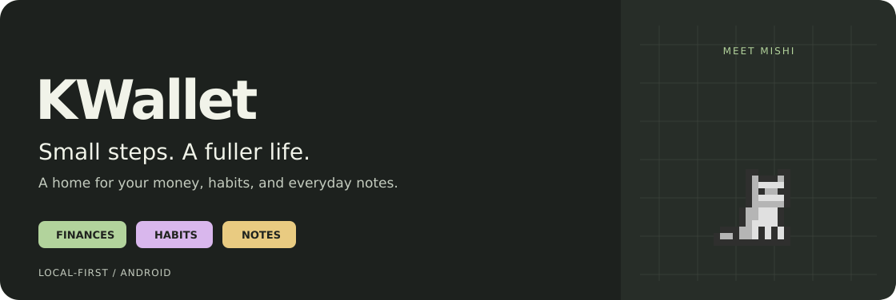
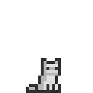

<div align="center">



**A little more clarity. A little more progress. A companion along the way.**

Personal finances, daily habits, and notes in one local-first Flutter app.


[Features](#features) · [How to use](#how-to-use) · [Run locally](#run-locally) · [Technology](#technology) · [Data and backups](#data-and-backups)

</div>

## Meet KWallet

Track what comes in, understand what goes out, and make room for everyday routines. KWallet brings your accounts, spending plans, notes, and habits together while a pixel companion grows with your progress.

Your everyday data lives on your device. You can use the app without connecting a GitHub account; cloud backup is optional. The current app interface is in Spanish; this guide is in English.

## Features

| | What you can do |
| :-- | :-- |
| **Money** | Manage multiple accounts, record income, expenses, and transfers, and organize transactions with categories. |
| **Budgets** | Plan daily, weekly, or monthly spending, with protected balances and planned commitments. |
| **Currencies** | Choose account currencies and maintain shared manual conversion rates with rate history. |
| **Planning** | Keep recurring payments and dated commitments on a calendar, then review upcoming cash flow. |
| **Habits** | Check in, review streaks and past days, group habits by time of day, and record how a day felt. |
| **Notes** | Keep free-form notes and checklists, with target dates for things that need a reminder. |
| **Companions** | Earn XP and grow a cat, rat, raccoon, opossum, rock, or plant through baby, adult, and master stages. |
| **Personalization** | Choose forest, plum, rose, or honey palettes and light, dark, or system appearance. |
| **Android extras** | Add a native cat home-screen widget and manage notification preferences. |
| **Backups** | Export and restore JSON files, use local recovery copies, or connect optional GitHub Gist backup. |

<div align="center">
  
  <br />
  <sub>The original adult cat, animated from the app's actual sprite sheet.</sub>
</div>

<details>
<summary><strong>A companion that grows with you</strong></summary>

Choose a companion during onboarding or change it in Settings. Built-in species have separate baby and adult artwork, plus color variants where available. Pets become adults at 200 XP and masters at 600 XP. Completing actions earns progress and triggers little reactions; you can also tap your companion to interact.

The Android home-screen widget uses its own cat artwork. The six-species picker belongs to the Flutter app.

</details>

## How to use

1. **Make it yours.** Finish onboarding, choose a companion, and pick your appearance and currency preferences.
2. **Add your accounts.** Give each account a name, opening balance, and currency. Set a minimum balance when you want to protect part of it.
3. **Record your day.** Add income, expenses, or transfers. Use categories and notes so your history stays easy to understand.
4. **Plan ahead.** Set a spending budget and add recurring or dated payments. Check the calendar before making new plans.
5. **Build a routine.** Create habits, check them off, and keep notes or lists beside your finances.
6. **Keep a backup.** Open Settings to export your data or connect the optional GitHub backup.

<details>
<summary><strong>Add the Android widget</strong></summary>

Long-press an empty area of your Android home screen, open the widget picker, and select the KWallet cat widget. Configure it through the native widget setup screen. Notification delivery depends on your app preferences and Android notification permission.

</details>

## Run locally

The repository includes **Android** and **Linux** targets. Use a Flutter SDK that includes Dart **3.13.5 or later within the 3.x series**, matching `pubspec.yaml`.

```sh
git clone https://github.com/MagusCat/kwallet.git
cd kwallet
flutter doctor
flutter pub get
flutter devices
```

Run on an attached Android device or emulator:

```sh
flutter run -d <device-id>
```

Or run the Linux desktop app:

```sh
flutter run -d linux
```

Android development needs the Android SDK and Java 17. Linux needs the Flutter desktop build dependencies (including GTK 3, CMake, Ninja, a C++ toolchain, and SQLite). Optional GitHub credentials on Linux also need `secret-tool` and an unlocked Secret Service keyring.

<details>
<summary><strong>Checks and release builds</strong></summary>

```sh
flutter analyze
flutter test
flutter build apk --release
flutter build linux --release
```

The APK is written to `build/app/outputs/flutter-apk/app-release.apk`. Configure your own Android release signing before distribution; the current Gradle configuration uses the debug signing key for release builds.

</details>

## Technology

| Layer | Technology | Role |
| :-- | :-- | :-- |
| Interface | Flutter, Material 3 | Shared mobile and desktop UI, themes, and responsive layouts. |
| Application | Dart, view models, repository contracts | Feature state and data operations kept separate from presentation. |
| Persistence | `sqflite`, `sqflite_common_ffi` | Local SQLite storage, migrations, transactions, and desktop database access. |
| Files and backup | `path_provider`, `path`, `file_picker`, `crypto` | Device files, portable JSON exports, and SHA-256 integrity checks. |
| Presentation | `flutter_animate`, `google_fonts`, `intl` | Motion, typography support, and value formatting. |
| Native integration | Android Kotlin and Flutter method channels | Home-screen widgets, notifications, and credential access. |
| Optional cloud | Dart `HttpClient`, GitHub Gists | User-triggered backup and restore with your GitHub account. |

Dependency versions are defined in [`pubspec.yaml`](pubspec.yaml) and resolved in [`pubspec.lock`](pubspec.lock).

## Data and backups

Everyday records are stored locally in SQLite. Data exports include the app's managed records, and restores validate the backup before replacing data in a transaction. Recovery copies help with database upgrades and failed restores.

- **JSON exports include a SHA-256 checksum.** It detects changes to the file; the backup itself is not encrypted.
- **Currency rates are manual.** Changing a symbol is not a currency conversion; review your configured rates when using converted values.
- **GitHub backup is optional.** Connect from Settings with a token that can access Gists, then use the sync or restore controls. Secret Gists are unlisted, not encrypted storage.
- **Credentials use the platform key store.** Android uses its native credential bridge; Linux uses Secret Service through `secret-tool`.

## Project layout

```text
assets/pets/       Adult and baby sprite sheets bundled with the app
android/           Android runner, widget resources, and native services
docs/media/        Public README banner and animation
lib/
  app/             App setup and shared dependencies
  core/            Database, contracts, services, themes, and shared widgets
  features/        Finance, journal, welcome, and settings features
linux/             Linux desktop runner
test/              Flutter unit and widget tests
tool/              Artwork import and preview/export tools
```

Internal plans, AI prompts, source references, and review documents live in the local `docs-ia/` directory, which is excluded from Git. Public documentation assets stay in `docs/media/`; runtime sprites stay in `assets/pets/`.

<details>
<summary><strong>Regenerate the README artwork</strong></summary>

With Node.js and ImageMagick installed:

```sh
node tool/export_readme_media.mjs
```

The exporter reads `assets/pets/cat.png`, uses the app's 32 × 32 cells and animation timings, and scales pixels without smoothing. It produces the animated banner, a still banner, and the adult-cat GIF in `docs/media/`. These are illustrations from the real game artwork, not app screenshots.

</details>
